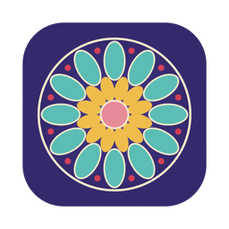
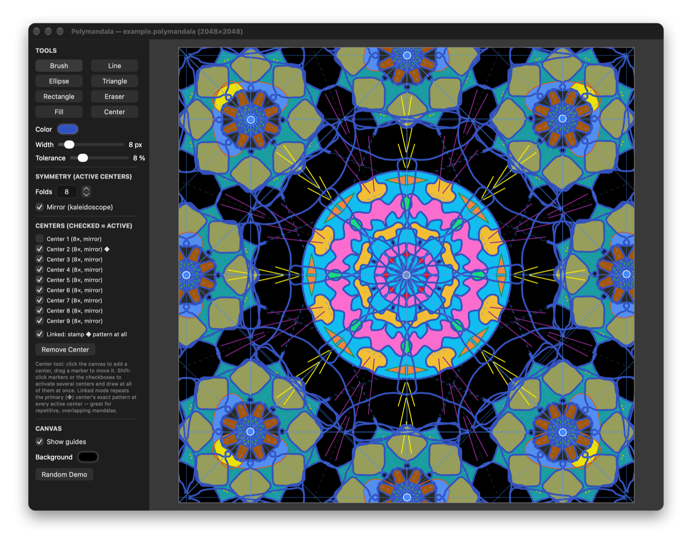
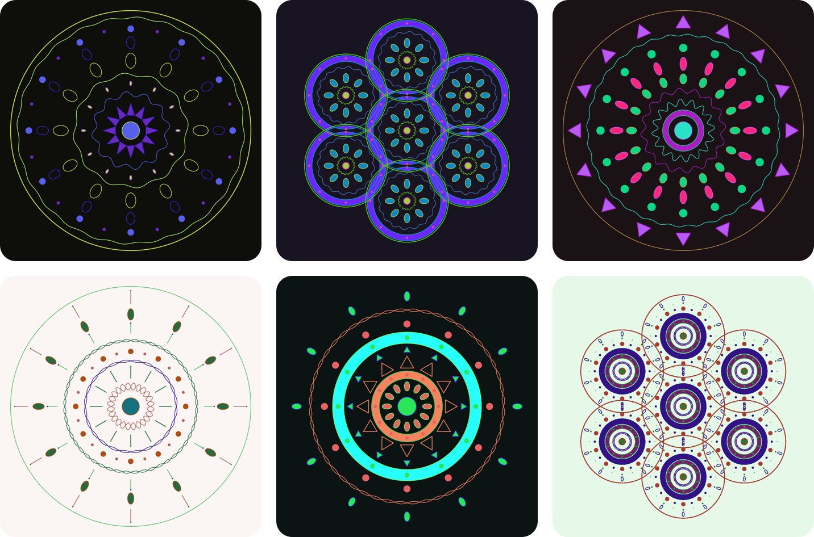
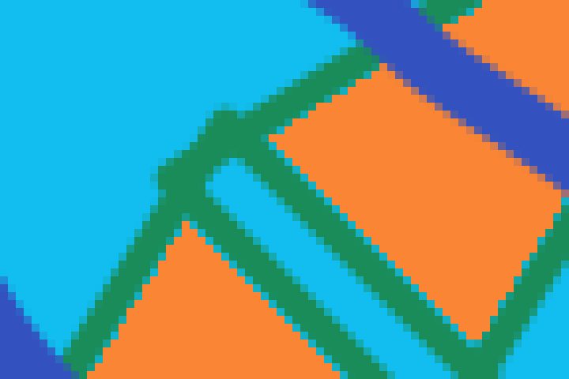
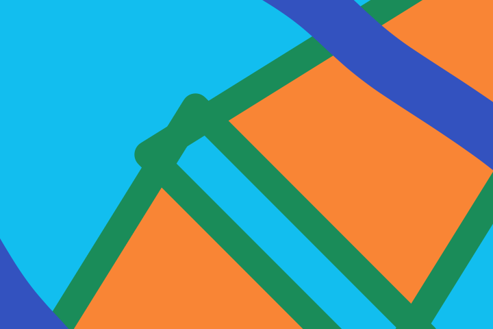
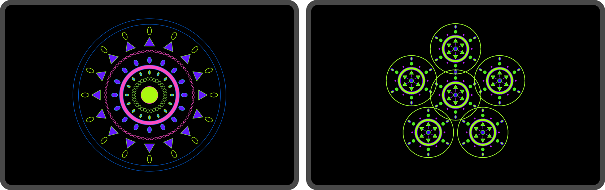

<div align="center">



# Polymandala

**Draw mandalas on your Mac.**<br>
Every stroke is rotated and mirrored live — around as many centers of symmetry as you like.




</div>

## A pure fun project

Polymandala exists because drawing symmetric patterns is fun, and for no other
reason. There is no business model, no account, no tracking — it does not even
use the network.

It is **free to use, modify and redistribute** under the [MIT license](LICENSE).
Take it apart, change it, build something else out of it.

## What it does

- **Live symmetry.** Whatever you draw appears 1 to 36 times around a center,
  optionally mirrored like in a kaleidoscope.
- **Many centers at once.** Place several centers of symmetry and draw at all
  of them simultaneously. In *linked* mode the pattern of one center is stamped
  identically at all the others — that is how the lattice in the screenshot
  above was made.
- **Drawing tools.** A smoothed freehand brush, line, ellipse, triangle,
  rectangle and eraser. Hold ⇧ for circles, squares, equilateral triangles and
  45° angles.
- **Symmetric flood fill.** One click fills the matching region in every sector
  and at every active center.
- **Random Demo.** Watch random mandalas being built stage by stage. Stop
  whenever you like and keep drawing on the result.
- **Export.** PNG at canvas resolution, SVG and PDF for any size, and printing.
- **The comfortable basics.** Undo and redo for every step, zoom up to 16× and
  pan, several drawings open side by side, autosave with crash recovery, and
  canvases up to 8192 × 8192 pixels.

## Random Demo

Not in the mood to draw? Press **⌘D** and let the app do it. Every mandala gets
its own palette, symmetry and layout, and what you end up with is a normal,
editable drawing.

<div align="center">

</div>

## SVG and PDF export

A PNG is limited to the resolution of the canvas. **File → Export → SVG…** and
**File → Export → PDF…** write the drawing as vector artwork instead, so it
stays sharp on a poster. Strokes and shapes are exported as exact curves; flood
fills are traced and tucked underneath the lines that enclose them, so the
lines stay crisp.

| PNG export, magnified 10× | SVG export, magnified 10× |
| :---: | :---: |
|  |  |

## The screensaver

Polymandala comes with a screensaver that builds random mandalas in bright
colors on black, one stage at a time, pauses on the finished picture and then
starts a new one.

It works with **multiple monitors**: every display builds its own, different
mandala.

<div align="center">

</div>

## Requirements

- A Mac with an **Apple M-series processor** (Apple silicon)
- macOS 13 Ventura or later

Polymandala is developed and tested on a current macOS; older versions back to
macOS 13 should work but have not been tried.

## Installing

### Download

Get `Polymandala-macos-arm64.dmg` from the [Releases](../../releases/latest)
page and open it. Drag **Polymandala** onto the Applications folder, and
double-click **PolymandalaSaver** if you want the screensaver as well.

The app is not notarized by Apple, so macOS blocks a downloaded copy the first
time you open it. Either allow it under **System Settings → Privacy & Security
→ Open Anyway**, or remove the download flag in Terminal:

```sh
xattr -dr com.apple.quarantine /Applications/Polymandala.app
```

### Build it yourself

You need a recent Xcode (Swift 5.9 or newer). There are no other dependencies.

```sh
cd Polymandala                # your clone of this repository
Scripts/build-app.sh          # → dist/Polymandala.app
Scripts/build-saver.sh        # → dist/PolymandalaSaver.saver
Scripts/build-dmg.sh          # → dist/Polymandala-macos-arm64.dmg (builds both first)
```

For a quick try without building a bundle, `swift run` starts the app directly.

### Installing the screensaver

Double-click `PolymandalaSaver.saver` and let macOS install it, or copy it into
your Screen Savers folder yourself. Then pick **Polymandala** in
**System Settings → Screen Saver**.

```sh
cp -R dist/PolymandalaSaver.saver ~/Library/Screen\ Savers/
```

A downloaded screensaver needs the same treatment as a downloaded app:

```sh
xattr -dr com.apple.quarantine ~/Library/Screen\ Savers/PolymandalaSaver.saver
```

## Getting started

1. Open the app and draw. The canvas starts with one center in the middle and
   8-fold mirrored symmetry.
2. Change **Folds** and **Mirror** in the sidebar to get a different symmetry.
3. Pick the **Center** tool and click the canvas to add more centers.
   Shift-click their markers to draw at several of them at once.
4. Use **Fill** to color the regions your lines enclose.
5. Save your work as a `.polymandala` document, or export it as PNG, SVG or PDF.

The full guide is in the app under **Help → Polymandala Help**. The drawing from
the screenshot is included as [`example.polymandala`](example.polymandala).

| Shortcut | Action |
| :--- | :--- |
| ⌘N | New canvas (size and background color) |
| ⌘O / ⌘S / ⇧⌘S | Open / Save / Save As |
| ⌘E / ⇧⌘E / ⌥⌘E | Export PNG / SVG / PDF |
| ⌘P | Print |
| ⌘Z / ⇧⌘Z | Undo / Redo |
| ⌘⌫ | Clear canvas (can be undone) |
| ⌘G | Show or hide the symmetry guides |
| ⌘+ / ⌘− / ⌘0 | Zoom in / Zoom out / Zoom to fit |
| ⌘D | Start or stop the Random Demo |
| ⌘? | Help |

Pinch to zoom around the cursor, and scroll with two fingers to pan while
zoomed in.

## Under the hood

Polymandala is plain Swift and AppKit, built with the Swift Package Manager —
no Xcode project and no third-party packages.

- A drawing is an ordered list of strokes and fills. Saving writes that list as
  JSON, and undo, redo and the vector export all work by replaying it.
- Every stroke remembers the centers of symmetry it was drawn with, so moving
  or changing a center later never disturbs what is already on the canvas.
- The app checks itself. This runs about a hundred headless tests, from the
  symmetry math to a pixel comparison of the SVG and PDF exports against the canvas:

  ```sh
  dist/Polymandala.app/Contents/MacOS/Polymandala --selftest
  ```

```
Sources/Polymandala/   the app: Model, Engine (rendering, fill, SVG and PDF export), UI
Saver/                 the screensaver view (shares the engine sources)
Scripts/               build scripts for the app, the screensaver, the disk image and the icon
Support/               Info.plist files and the app icon
Tools/                 the programs that draw the app icon and the disk image backdrop
Images/                pictures for this README
```

## Credits and license

Concept by Hanno Teeling.<br>
Initial implementation by Claude Fable 5.<br>
Refinement by Claude Opus 5.5 and Fable 5.2.

Released under the [MIT license](LICENSE).
